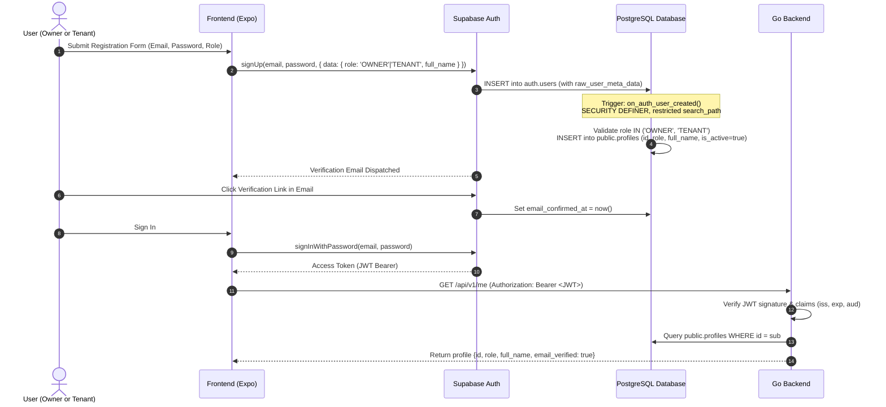
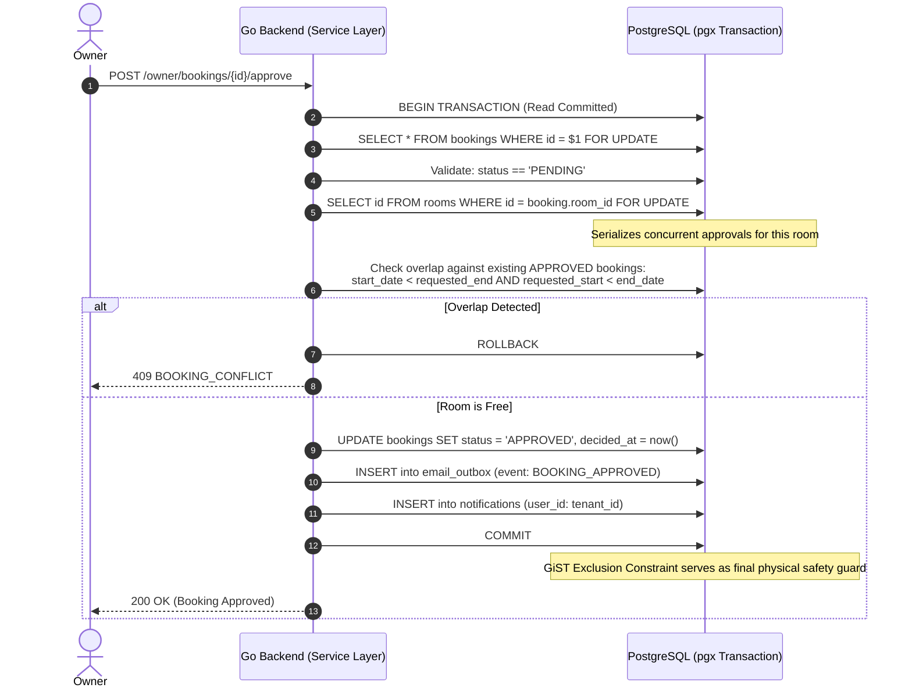

# Kostly — System Architecture

**Version:** 2.1  
**Status:** Approved Baseline — Full Technical & Domain Alignment  
**Last updated:** 20 November 2026  

---

## 1. Architecture Overview

Kostly is organized as a monorepo containing a universal cross-platform frontend, a Go modular monolith backend, and centralized technical documentation.

```
┌────────────────────────────────────────────────────────────────────────┐
│                        Universal Client Tier                           │
│       React Native + Expo (Web, Android, iOS) Single Codebase          │
└───────────────────┬────────────────────────────────┬───────────────────┘
                    │                                │
      Authentication & Tokens           API Requests (Bearer JWT)
                    │                                │
                    ▼                                ▼
┌───────────────────────────────┐  ┌─────────────────────────────────────┐
│         Supabase BaaS         │  │             Go Backend              │
│  - Supabase Auth              │  │  - Gin HTTP Router                  │
│  - Supabase Storage (Buckets) │  │  - Modular Monolith Architecture    │
│  - Supabase PostgreSQL (Host) │  │  - Service-Layer Authorization      │
└───────────────┬───────────────┘  │  - Transactional Business Logic     │
                │                  │  - Outbox Notification Dispatcher   │
                │                  └──────────────────┬──────────────────┘
                │                                     │
                │    Privileged Connection (pgxpool)  │
                └─────────────────────────────────────┘
```

- **Frontend:** React Native + Expo + TypeScript + Expo Router (universal responsive UI for Web, Android, iOS).
- **Backend:** Go modular monolith using the Gin web framework.
- **Authentication:** Supabase Auth for identity, credential management, email verification, and password recovery.
- **Database:** PostgreSQL hosted on Supabase, managed via Go backend with `pgx/v5` connection pooling and `golang-migrate` for schema migrations.
- **Storage:** Supabase Storage with dedicated public buckets (listings) and private buckets (report proof attachments, avatars).
- **API Style:** RESTful JSON API versioned under `/api/v1`.

---

## 2. Repository Layout

```text
kostly/
├── frontend/                      # Universal Expo application
│   ├── app/                       # Expo Router file-based routes
│   │   ├── _layout.tsx            # Global layout & auth provider
│   │   ├── (auth)/                # Separate Owner & Tenant registration / login
│   │   ├── (owner)/               # Owner dashboard, properties, bookings, reports
│   │   └── (tenant)/              # Tenant explore, bookings, change requests, reports
│   ├── src/
│   │   ├── components/            # UI components (cards, forms, dialogs)
│   │   ├── features/              # Domain features & screens
│   │   ├── hooks/                 # Custom React hooks
│   │   ├── services/              # API clients calling Go backend
│   │   ├── types/                 # Shared TypeScript models
│   │   └── utils/                 # Formatting & responsive helpers
│   ├── app.json
│   ├── package.json
│   └── tsconfig.json
├── backend/                       # Go modular monolith API
│   ├── cmd/
│   │   └── api/
│   │       └── main.go            # Application lifecycle & graceful shutdown
│   ├── internal/
│   │   ├── config/                # Environment configuration loading & validation
│   │   ├── database/              # PostgreSQL pool initialization (pgxpool)
│   │   ├── middleware/            # CORS, Auth JWT verification, Error recovery
│   │   ├── router/                # Gin engine & route group registry
│   │   ├── modules/               # Domain modules (Handler -> Service -> Repository)
│   │   │   ├── auth/              # Profile, credential & deactivation management
│   │   │   ├── property/          # Properties, facilities & property images
│   │   │   ├── room/              # Rooms & room images
│   │   │   ├── booking/           # Bookings, change requests, expiration & locks
│   │   │   ├── notification/      # In-app alerts, email outbox & preferences
│   │   │   └── report/            # Property reports, evidence photos & owner responses
│   │   └── shared/
│   │       ├── response/          # Standard JSON envelopes ({data}, {error})
│   │       └── validator/         # Custom request validation rules
│   ├── db/
│   │   └── migrations/            # Sequential SQL migrations (golang-migrate)
│   ├── docs/                      # Backend-specific guides (e.g. migrations.md)
│   ├── .env.example
│   ├── go.mod
│   └── go.sum
├── docs/                          # Source of truth specifications
│   ├── PRD.md
│   ├── Architecture.md
│   ├── ERD.md
│   ├── API-Specification.md
│   └── Design.md
├── .gitignore
└── README.md
```

---

## 3. Frontend Architecture

### Core Stack
- **Framework:** Expo (React Native) with React Native Web support.
- **Navigation:** Expo Router with platform-agnostic file-based routing.
- **Server State & Caching:** TanStack Query (`@tanstack/react-query`) for API fetching, caching, and optimistic updates.
- **Client State:** Zustand for lightweight client-only states (e.g., active filters, responsive navigation states).
- **Forms & Validation:** React Hook Form with Zod schemas.
- **Auth Client:** `@supabase/supabase-js` solely for authentication, session recovery, and token storage.
- **Sensitive Storage:** Expo SecureStore for mobile platforms; secure browser storage for web.

### Responsive UI Strategy
- Breakpoints: Mobile (< 768px), Tablet (768px–1023px), Desktop (≥ 1024px).
- Navigation adapts dynamically: bottom tab bar on mobile, persistent collapsible sidebar on desktop.
- Single codebase renders natively on iOS/Android and in modern web browsers without dual code paths for business logic.

---

## 4. Backend Architecture: Modular Monolith

The backend uses a strict **Layered Modular Monolith** pattern:

```
HTTP Request ──► [Gin Middleware: Auth/CORS/Recovery]
                       │
                       ▼
             [Module HTTP Handler]
                       │ (Validates input, extracts User Claims)
                       ▼
             [Module Service Layer]
                       │ (Enforces role rules, ownership, business invariants, transactions)
                       ▼
            [Module Repository Layer]
                       │ (Executes SQL queries via pgx)
                       ▼
              [Supabase PostgreSQL]
```

### Architectural Invariants:
1. **Dependency Injection:** Handlers, Services, and Repositories are wired via explicit constructor parameters.
2. **Layer Isolation:** Handlers never touch SQL or database pools; Services never inspect HTTP contexts (`gin.Context`); Repositories never make business decisions.
3. **Internal Package Protection:** Modules reside inside `internal/modules/` and cannot be imported by external Go applications.
4. **Cross-Module Communication:** Modules interact via exposed Service interfaces or shared domain events, never by reaching into another module's repository or database tables directly.

---

## 5. Authentication, Authorization & Identity Lifecycle

### 5.1. Registration & Profile Provisioning Flow


### 5.2. Trigger Security & Specification
The provisioning trigger on `auth.users` must adhere to security best practices:
```sql
CREATE OR REPLACE FUNCTION public.handle_new_user()
RETURNS trigger
LANGUAGE plpgsql
SECURITY DEFINER
SET search_path = public, auth, pg_temp
AS $$
DECLARE
    assigned_role text;
    user_full_name text;
BEGIN
    assigned_role := NEW.raw_user_meta_data->>'role';
    user_full_name := COALESCE(NEW.raw_user_meta_data->>'full_name', 'User');

    -- Strictly enforce valid roles; reject registration if invalid or missing
    IF assigned_role IS NULL OR assigned_role NOT IN ('OWNER', 'TENANT') THEN
        RAISE EXCEPTION 'Registration rejected: valid role (OWNER or TENANT) is required.';
    END IF;

    INSERT INTO public.profiles (id, role, full_name, created_at, updated_at)
    VALUES (NEW.id, assigned_role, user_full_name, now(), now());

    RETURN NEW;
END;
$$;

CREATE OR REPLACE TRIGGER on_auth_user_created
AFTER INSERT ON auth.users
FOR EACH ROW EXECUTE FUNCTION public.handle_new_user();
```

### 5.3. Email Verification Enforcement
1. **Frontend Gate:** If `email_confirmed_at` is null, Expo Router redirects immediately to `/(auth)/verify-pending`.
2. **Backend Gate:** The `middleware.RequireVerifiedUser()` extracts the JWT claims. If the token indicates unverified email, the request is aborted with `403 FORBIDDEN` (`code: "EMAIL_VERIFICATION_REQUIRED"`).

### 5.4. Account Deactivation & Email Reuse Architecture
- **Permanent Deactivation:** When an account with booking history requests deletion, the profile is flagged `is_active = false` and `deactivated_at = now()`.
- **Preserving Foreign Key Integrity:** `profiles.id` is never physically deleted so that historical bookings, change requests, and reports retain relational integrity.
- **Solving the Supabase Auth Email Constraint:** Supabase Auth enforces a unique constraint on `auth.users(email)`. To allow a user to reuse their email after deactivating their old account:
  - The Go backend administrative service invokes the Supabase Admin API to update the old account's email in `auth.users` to an aliased tombstone: `deactivated_{uuid}@deleted.kostly.local`.
  - This immediately frees up the real email address in `auth.users`.
  - When the user registers anew, Supabase Auth creates a brand new `auth.users` UUID and the trigger creates a brand new `public.profiles` record. Historical records remain permanently tied to the old profile UUID.

---

## 6. Database Connectivity & Security Strategy

### 6.1. Connection Architecture
- The Go backend connects via `pgxpool` using the database administrative connection string (`DATABASE_URL`).
- Connection limits and lifecycles are tuned for cloud resilience:
  - `MaxConns: 10`, `MinConns: 2`
  - `MaxConnLifetime: 30 minutes`, `MaxConnIdleTime: 5 minutes`
  - Health check period: `1 minute`.

### 6.2. Role-Based Access Control vs. Supabase RLS
- The Go backend connects as the privileged PostgreSQL user (`postgres`). By PostgreSQL design, superuser/privileged connections bypass Row Level Security (RLS) policies by default.
- **Authoritative Authorization in Go Service Layer:** The backend service layer strictly validates:
  - `owner_id == authenticated_sub` for all property/room/decision operations.
  - `tenant_id == authenticated_sub` for all booking submissions, cancellations, and change requests.
  - Strips confidential fields (e.g. `reporter_id`) before serializing JSON responses.
- **RLS as Defense-in-Depth:** RLS is enabled on all tables in Supabase with zero public access rules, ensuring that accidental direct API exposure through Supabase's auto-generated PostgREST endpoints is completely blocked.

---

## 7. Storage Architecture

Supabase Storage is utilized for all binary image assets.

```
Supabase Storage Buckets
├── properties (Public CDN)
│   └── {property_id}/{image_uuid}.jpg
├── rooms (Public CDN)
│   └── {room_id}/{image_uuid}.jpg
├── avatars (Private Bucket - Signed URLs)
│   └── {profile_id}/avatar.jpg
└── reports (Private Bucket - Signed URLs)
    └── {report_id}/{image_uuid}.jpg
```

1. **Listing Photos (`properties`, `rooms`):** Stored in public buckets to allow fast, cached CDN delivery to browsing tenants.
2. **Sensitive Photos (`reports`, `avatars`):**
   - Stored in strictly **private** buckets.
   - The Go backend validates that the requesting caller is permitted to view the evidence (e.g., filing Tenant, owning Owner, or platform operator).
   - The backend issues short-lived Supabase Storage Signed URLs (e.g., 15-minute expiry).
3. **Lifecycle & Cleanup:** When a property image, room image, or report photo is deleted or replaced, the corresponding object is removed from Supabase Storage via backend storage service hooks.

---

## 8. Booking Concurrency & Consistency Architecture

Booking approval is the most critical transactional operation in Kostly.



### Multi-Layer Consistency Enforcement:
1. **Application Row-Locking:** Serializes competing requests on the room row (`SELECT ... FOR UPDATE`).
2. **Database Engine Backstop (GiST Exclusion Constraint):**
   ```sql
   ALTER TABLE bookings
   ADD CONSTRAINT bookings_no_overlapping_approved
   EXCLUDE USING gist (
       room_id WITH =,
       daterange(start_date, end_date, '[)') WITH &&
   ) WHERE (status = 'APPROVED');
   ```
   Even under network partitions or distributed race conditions, PostgreSQL guarantees that two approved bookings for the same room can never overlap.
3. **Duplicate Request Prevention:**
   A partial index or constraint prevents a Tenant from creating overlapping pending or approved requests for the exact same room:
   ```sql
   CREATE UNIQUE INDEX idx_bookings_tenant_no_duplicate_active
   ON bookings (tenant_id, room_id, daterange(start_date, end_date, '[)'))
   WHERE (status IN ('PENDING', 'APPROVED'));
   ```

### 72-Hour Expiration Worker
- Pending bookings expire automatically after 72 hours.
- A periodic Go background job (or PostgreSQL `pg_cron` schedule) runs:
  ```sql
  UPDATE bookings
  SET status = 'EXPIRED', updated_at = now()
  WHERE status = 'PENDING' AND created_at < now() - INTERVAL '72 hours';
  ```
- Generates `BOOKING_EXPIRED` notifications for affected tenants.

### 8.4. Property & Room Deletion Reconciliation Architecture
To reconcile the requirements of room hard-deletion with strict property retention:

1. **Room Hard-Deletion with Cascade:**
   - When an owner deletes a room via `DELETE /owner/rooms/{id}`, PostgreSQL executes an `ON DELETE CASCADE` across:
     - `bookings` (and transitively `booking_change_requests`).
     - `room_images`.
   - The Go backend issues a background task to clean up the orphaned image files in Supabase Storage.
   - Deleting a room with historical bookings is explicitly permitted.
2. **Property Deletion Guard via Persistent Marker (`has_booking_history`):**
   - The `properties` table includes a dedicated persistent column: `has_booking_history BOOLEAN NOT NULL DEFAULT FALSE`.
   - A PostgreSQL trigger on `bookings AFTER INSERT` (or the Go booking service transaction) sets this flag upon the creation of the very first booking on any room of that property:
     ```sql
     UPDATE public.properties
     SET has_booking_history = true
     WHERE id = (SELECT property_id FROM public.rooms WHERE id = NEW.room_id)
       AND has_booking_history = false;
     ```
   - **Non-Reversible Rule:** Once flipped to `TRUE`, `has_booking_history` **never reverts to `FALSE`**, even if all rooms or cascaded booking rows are later deleted.
   - **Deletion Guard:** Before executing `DELETE FROM properties WHERE id = $1`, the Go service layer checks `has_booking_history`. If `TRUE`, the operation is aborted with `409 Conflict` (`code: "PROPERTY_HAS_BOOKING_HISTORY"`). This prevents owners from bypassing property retention by deleting rooms first.

---

## 9. Notification & Email Outbox Architecture

To ensure high availability and non-blocking API calls, email sending employs the **Transactional Outbox Pattern**:

```
[Business Operation] ──► BEGIN TX ──► [Update Booking Status]
                                  ──► [Insert into notifications]
                                  ──► [Insert into email_outbox]
                                  ──► COMMIT TX

[Outbox Worker] ──(Polls pending outbox jobs)──► [Check User Email Preferences]
                                            ──► [Send via SMTP / Resend API]
                                            ──► [Mark job PROCESSED / FAILED]
```

1. **Failure Isolation:** If the email provider fails or experiences latency, the booking approval or status change is already safely committed to the database.
2. **Preferences Enforcement:** Before sending an email, the worker checks `notification_preferences`. If the user has disabled emails for that category, the outbox record is marked `SKIPPED`.
3. **Supabase Auth Isolation:** System emails (email verification, forgot password, password recovery) are handled by Supabase Auth's native mailer, completely independent of the application outbox worker.

---

## 10. Property Reporting Architecture

1. **Confidentiality Pipeline:**
   - Anonymous report: `reporter_id` column is stored as `NULL`.
   - Identified report: `reporter_id` contains the tenant UUID.
   - When the Owner queries `/owner/reports`, the Handler/Service layer omits `reporter_id` entirely from the serialized response payload.
2. **Owner Responses Isolation:**
   - Owner responses are stored in `property_report_owner_responses`.
   - These records are private between the Owner and Kostly platform operators. The Tenant API endpoints never load or return this table.
3. **State Machine Locks:**
   - Report content (description, category, proof images) is editable by Tenant only while status is `SUBMITTED`.
   - Transitions to `UNDER_REVIEW`, `RESOLVED`, or `DISMISSED` lock the report fields and evidence permanently.
   - Owner responses can be edited/deleted only while `SUBMITTED` or `UNDER_REVIEW`. Locked upon `RESOLVED` or `DISMISSED`.

---

## 11. Deployment & Environment Strategy

1. **Frontend Hosting:**
   - Web: Exported via Expo Web and hosted on a static edge CDN (Cloudflare Pages or Vercel).
   - Mobile: Compiled into native `.apk` / `.aab` / `.ipa` packages via EAS Build.
2. **Backend Service:**
   - Containerized Go binary deployed to a container runner (e.g. Fly.io, Railway, Google Cloud Run).
   - Configured via environment variables (`APP_ENV`, `APP_PORT`, `DATABASE_URL`, `SUPABASE_URL`, `SUPABASE_JWKS_URL`, `CORS_ALLOWED_ORIGINS`).
3. **Database & Auth:**
   - Hosted on Supabase (ap-northeast-1 / Jakarta / Singapore regional cluster).
