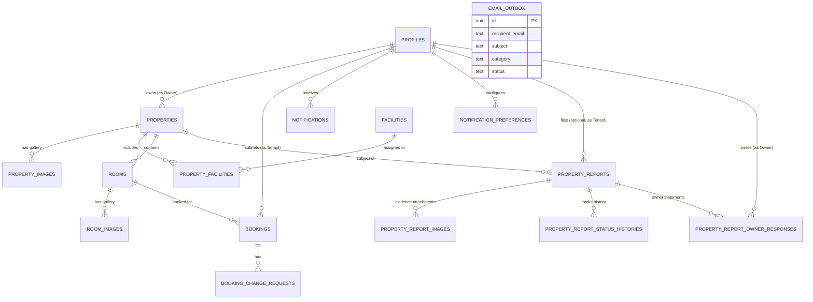

# Kostly — Entity Relationship Design (ERD)

**Version:** 2.0  
**Status:** Approved Baseline — Full Feature & Domain Alignment  
**Last updated:** 20 November 2026  

---

## 1. Database Conventions & Standards

- **Engine:** PostgreSQL (Supabase-hosted).
- **Primary Keys:** All tables use UUID primary keys (`gen_random_uuid()`).
- **Timestamps:** Stored strictly as `timestamptz` with UTC time zone.
- **Calendar Dates:** Rental start and end boundaries are stored as `date` (`YYYY-MM-DD`).
- **Monetary Values:** Currency is strictly Indonesian Rupiah (**IDR**). All prices and sums use PostgreSQL **`BIGINT`** (no floating-point or fractional numbers).
- **Status & Enums:** Enforced via `text` columns with explicit `CHECK (status IN (...))` constraints to maintain migration flexibility.
- **Half-Open Intervals:** Rental bookings utilize half-open intervals: `[start_date, end_date)`.
- **Identity Reference:** `profiles.id` is a 1:1 foreign key referencing Supabase Auth's `auth.users.id`.
- **Deliberate Deletion Behavior:** Avoid blanket `CASCADE` deletion on historical business entities (especially bookings and completed reports).

---

## 2. Entity Definitions

### 2.1. Core Entities

#### `profiles`
User profile associated with an authenticated Supabase user.

| Column | Type | Nullable | Notes |
|---|---|---|---|
| `id` | `uuid` | No | PK. Foreign Key → `auth.users(id) ON DELETE CASCADE` |
| `role` | `text` | No | `CHECK (role IN ('OWNER', 'TENANT'))` |
| `full_name` | `text` | No | User full name |
| `phone` | `text` | Yes | Contact phone number |
| `avatar_path` | `text` | Yes | Private storage path in `avatars` bucket |
| `is_active` | `boolean` | No | Default `true`. `false` indicates permanently deactivated |
| `deactivated_at` | `timestamptz` | Yes | Timestamp of account deactivation |
| `created_at` | `timestamptz` | No | Default `now()` |
| `updated_at` | `timestamptz` | No | Default `now()` |

* **Indexes:**
  * `CREATE INDEX idx_profiles_role ON profiles(role);`

---

#### `facilities`
Catalog of standard boarding-house facilities.

| Column | Type | Nullable | Notes |
|---|---|---|---|
| `id` | `uuid` | No | PK. Default `gen_random_uuid()` |
| `name` | `text` | No | Unique facility name (e.g., Wi-Fi, AC, Parkir Motor) |
| `created_at` | `timestamptz` | No | Default `now()` |

* **Constraints & Indexes:**
  * `UNIQUE (name)`

---

#### `properties`
Boarding-house property owned by an Owner.

| Column | Type | Nullable | Notes |
|---|---|---|---|
| `id` | `uuid` | No | PK. Default `gen_random_uuid()` |
| `owner_id` | `uuid` | No | FK → `profiles(id) ON DELETE RESTRICT` |
| `name` | `text` | No | Property title |
| `description` | `text` | Yes | Detailed description |
| `address` | `text` | No | Street address |
| `city` | `text` | No | City |
| `province` | `text` | No | Province |
| `latitude` | `numeric` | Yes | WGS84 GPS latitude |
| `longitude` | `numeric` | Yes | WGS84 GPS longitude |
| `status` | `text` | No | Default `'DRAFT'`. `CHECK (status IN ('DRAFT', 'PUBLISHED', 'ARCHIVED'))` |
| `has_booking_history` | `boolean` | No | Default `false`. Persistent marker set to `true` on first booking; never reverts to `false` |
| `created_at` | `timestamptz` | No | Default `now()` |
| `updated_at` | `timestamptz` | No | Default `now()` |

* **Constraints & Indexes:**
  * `CHECK (latitude IS NULL OR (latitude >= -90 AND latitude <= 90))`
  * `CHECK (longitude IS NULL OR (longitude >= -180 AND longitude <= 180))`
  * `CREATE INDEX idx_properties_owner_id ON properties(owner_id);`
  * `CREATE INDEX idx_properties_status_city ON properties(status, city);`
  * `CREATE INDEX idx_properties_booking_history ON properties(has_booking_history);`

* **Database Protection Mechanisms for `has_booking_history`:**
  1. **Automatic Activation Trigger:** Trigger `AFTER INSERT ON bookings` automatically executes:
     ```sql
     UPDATE public.properties
     SET has_booking_history = true
     WHERE id = (SELECT property_id FROM public.rooms WHERE id = NEW.room_id)
       AND has_booking_history = false;
     ```
  2. **Immutability Trigger (Prevent Reversal):** Trigger `BEFORE UPDATE OF has_booking_history ON properties` guarantees that once `has_booking_history` becomes `true`, any attempt to revert it back to `false` raises an exception:
     ```sql
     IF OLD.has_booking_history = true AND NEW.has_booking_history = false THEN
         RAISE EXCEPTION 'Illegal state transition: has_booking_history cannot be reverted to false';
     END IF;
     ```
  3. **Hard-Deletion Guard Trigger:** Trigger `BEFORE DELETE ON properties` strictly blocks physical deletion if `has_booking_history = true`:
     ```sql
     IF OLD.has_booking_history = true THEN
         RAISE EXCEPTION 'Deletion rejected: property has historical booking records and cannot be deleted';
     END IF;
     ```
  4. **Cascade Resilience:** Because `has_booking_history` is a persistent column residing directly in the `properties` table row, deleting rooms and their associated bookings via `ON DELETE CASCADE` **does not** modify or reset `has_booking_history`. The deletion guard trigger continues to protect the property from hard deletion even if all rooms and historical bookings have been wiped out.

---

#### `property_images`
Photos uploaded for a property gallery.

| Column | Type | Nullable | Notes |
|---|---|---|---|
| `id` | `uuid` | No | PK. Default `gen_random_uuid()` |
| `property_id` | `uuid` | No | FK → `properties(id) ON DELETE CASCADE` |
| `storage_path` | `text` | No | Supabase Storage path in public bucket |
| `alt_text` | `text` | Yes | Accessible description |
| `sort_order` | `integer` | No | Default `0`. Order in display gallery |
| `created_at` | `timestamptz` | No | Default `now()` |

* **Indexes:**
  * `CREATE INDEX idx_property_images_property_sort ON property_images(property_id, sort_order ASC);`

---

#### `property_facilities`
Many-to-many relationship linking properties with facilities.

| Column | Type | Nullable | Notes |
|---|---|---|---|
| `property_id` | `uuid` | No | PK Part. FK → `properties(id) ON DELETE CASCADE` |
| `facility_id` | `uuid` | No | PK Part. FK → `facilities(id) ON DELETE RESTRICT` |

* **Constraints & Indexes:**
  * `PRIMARY KEY (property_id, facility_id)`
  * `CREATE INDEX idx_property_facilities_facility_id ON property_facilities(facility_id);`

---

#### `rooms`
Rentable room within a property.

| Column | Type | Nullable | Notes |
|---|---|---|---|
| `id` | `uuid` | No | PK. Default `gen_random_uuid()` |
| `property_id` | `uuid` | No | FK → `properties(id) ON DELETE CASCADE` |
| `name` | `text` | No | Room label/identifier (e.g., Kamar 101, Tipe A) |
| `description` | `text` | Yes | Room specifications |
| `monthly_price` | `bigint` | No | Price in IDR. `CHECK (monthly_price > 0)` |
| `capacity` | `integer` | No | Default `1`. `CHECK (capacity > 0)` |
| `status` | `text` | No | Default `'ACTIVE'`. `CHECK (status IN ('ACTIVE', 'INACTIVE', 'MAINTENANCE'))` |
| `created_at` | `timestamptz` | No | Default `now()` |
| `updated_at` | `timestamptz` | No | Default `now()` |

* **Constraints & Indexes:**
  * `CREATE INDEX idx_rooms_property_status ON rooms(property_id, status);`

---

#### `room_images`
Photos uploaded for a room gallery.

| Column | Type | Nullable | Notes |
|---|---|---|---|
| `id` | `uuid` | No | PK. Default `gen_random_uuid()` |
| `room_id` | `uuid` | No | FK → `rooms(id) ON DELETE CASCADE` |
| `storage_path` | `text` | No | Supabase Storage path in public bucket |
| `alt_text` | `text` | Yes | Accessible description |
| `sort_order` | `integer` | No | Default `0`. Order in display gallery |
| `created_at` | `timestamptz` | No | Default `now()` |

* **Indexes:**
  * `CREATE INDEX idx_room_images_room_sort ON room_images(room_id, sort_order ASC);`

---

### 2.2. Booking Entities

#### `bookings`
Tenant monthly rental booking requests.

| Column | Type | Nullable | Notes |
|---|---|---|---|
| `id` | `uuid` | No | PK. Default `gen_random_uuid()` |
| `tenant_id` | `uuid` | No | FK → `profiles(id) ON DELETE RESTRICT` |
| `room_id` | `uuid` | No | FK → `rooms(id) ON DELETE CASCADE` |
| `start_date` | `date` | No | Inclusive rental start date |
| `end_date` | `date` | No | Exclusive rental end date |
| `duration_months` | `integer` | No | Positive calendar months. `CHECK (duration_months > 0)` |
| `monthly_price_snapshot` | `bigint` | No | Price in IDR at request time. `CHECK (monthly_price_snapshot > 0)` |
| `total_price` | `bigint` | No | Calculated by backend. `CHECK (total_price > 0)` |
| `status` | `text` | No | Default `'PENDING'`. `CHECK (status IN ('PENDING', 'APPROVED', 'REJECTED', 'CANCELLED', 'EXPIRED'))` |
| `decision_note` | `text` | Yes | Owner note on approval or rejection |
| `decided_at` | `timestamptz` | Yes | Timestamp of approval/rejection decision |
| `cancelled_by` | `uuid` | Yes | FK → `profiles(id) ON DELETE SET NULL` |
| `cancellation_reason` | `text` | Yes | Mandatory reason when booking is cancelled |
| `cancelled_at` | `timestamptz` | Yes | Timestamp of cancellation |
| `created_at` | `timestamptz` | No | Default `now()` |
| `updated_at` | `timestamptz` | No | Default `now()` |

* **Constraints & Indexes:**
  * `CHECK (end_date > start_date)`
  * `CREATE INDEX idx_bookings_tenant_created ON bookings(tenant_id, created_at DESC);`
  * `CREATE INDEX idx_bookings_room_status_dates ON bookings(room_id, status, start_date, end_date);`
  * `CREATE INDEX idx_bookings_pending_expiration ON bookings(status, created_at) WHERE status = 'PENDING';`
  * **Exclusion Constraint (Prevent Overlapping Approved Bookings):**
    ```sql
    ALTER TABLE bookings
    ADD CONSTRAINT bookings_no_overlapping_approved
    EXCLUDE USING gist (
        room_id WITH =,
        daterange(start_date, end_date, '[)') WITH &&
    ) WHERE (status = 'APPROVED');
    ```
  * **Exclusion Constraint (Prevent Duplicate Active Bookings by Same Tenant):**
    ```sql
    ALTER TABLE bookings
    ADD CONSTRAINT bookings_no_duplicate_tenant_active
    EXCLUDE USING gist (
        tenant_id WITH =,
        room_id WITH =,
        daterange(start_date, end_date, '[)') WITH &&
    ) WHERE (status IN ('PENDING', 'APPROVED'));
    ```

---

#### `booking_change_requests`
Requests submitted by tenants to alter the dates of an approved booking.

| Column | Type | Nullable | Notes |
|---|---|---|---|
| `id` | `uuid` | No | PK. Default `gen_random_uuid()` |
| `booking_id` | `uuid` | No | FK → `bookings(id) ON DELETE CASCADE` |
| `requested_start_date` | `date` | No | Proposed inclusive start date |
| `requested_end_date` | `date` | No | Proposed exclusive end date |
| `requested_duration_months`| `integer` | No | Proposed months. `CHECK (requested_duration_months > 0)` |
| `new_monthly_price_snapshot`| `bigint`| No | Price snapshot. `CHECK (new_monthly_price_snapshot > 0)` |
| `new_total_price` | `bigint` | No | New total. `CHECK (new_total_price > 0)` |
| `status` | `text` | No | Default `'PENDING'`. `CHECK (status IN ('PENDING', 'APPROVED', 'REJECTED', 'CANCELLED'))` |
| `rejection_reason` | `text` | Yes | Mandatory when Owner rejects change request |
| `decided_at` | `timestamptz` | Yes | Timestamp of approval/rejection |
| `created_at` | `timestamptz` | No | Default `now()` |
| `updated_at` | `timestamptz` | No | Default `now()` |

* **Constraints & Indexes:**
  * `CHECK (requested_end_date > requested_start_date)`
  * `CREATE UNIQUE INDEX idx_booking_change_requests_single_pending ON booking_change_requests(booking_id) WHERE status = 'PENDING';` (Guarantees exactly one pending change request per booking).

---

### 2.3. Notification Entities

#### `notifications`
In-app alerts delivered to users.

| Column | Type | Nullable | Notes |
|---|---|---|---|
| `id` | `uuid` | No | PK. Default `gen_random_uuid()` |
| `user_id` | `uuid` | No | FK → `profiles(id) ON DELETE CASCADE` |
| `type` | `text` | No | Event type (e.g., `BOOKING_APPROVED`, `REPORT_STATUS_CHANGED`) |
| `title` | `text` | No | Display title |
| `body` | `text` | No | Display text |
| `data` | `jsonb` | Yes | Relevant resource identifiers |
| `read_at` | `timestamptz` | Yes | `NULL` = unread |
| `created_at` | `timestamptz` | No | Default `now()` |

* **Indexes:**
  * `CREATE INDEX idx_notifications_user_unread ON notifications(user_id, read_at, created_at DESC);`

---

#### `notification_preferences`
User opt-in settings for asynchronous email notifications.

| Column | Type | Nullable | Notes |
|---|---|---|---|
| `id` | `uuid` | No | PK. Default `gen_random_uuid()` |
| `user_id` | `uuid` | No | FK → `profiles(id) ON DELETE CASCADE` |
| `category` | `text` | No | Category (e.g., `'BOOKINGS'`, `'REPORTS'`) |
| `email_enabled` | `boolean` | No | Default `true` |
| `created_at` | `timestamptz` | No | Default `now()` |
| `updated_at` | `timestamptz` | No | Default `now()` |

* **Constraints & Indexes:**
  * `UNIQUE (user_id, category)`

---

#### `email_outbox`
Transactional outbox queue for reliable asynchronous email delivery.

| Column | Type | Nullable | Notes |
|---|---|---|---|
| `id` | `uuid` | No | PK. Default `gen_random_uuid()` |
| `recipient_email` | `text` | No | Destination email address |
| `subject` | `text` | No | Email subject line |
| `body_html` | `text` | No | Formatted HTML content |
| `category` | `text` | No | Category for preference filtering |
| `status` | `text` | No | Default `'PENDING'`. `CHECK (status IN ('PENDING', 'PROCESSED', 'FAILED', 'SKIPPED'))` |
| `retry_count` | `integer` | No | Default `0` |
| `last_error` | `text` | Yes | Diagnostic failure information |
| `sent_at` | `timestamptz` | Yes | Time of successful dispatch |
| `created_at` | `timestamptz` | No | Default `now()` |
| `updated_at` | `timestamptz` | No | Default `now()` |

* **Indexes:**
  * `CREATE INDEX idx_email_outbox_pending ON email_outbox(status, created_at) WHERE status = 'PENDING';`

---

### 2.4. Property Reporting Entities

#### `property_reports`
Reports submitted by tenants regarding property issues.

| Column | Type | Nullable | Notes |
|---|---|---|---|
| `id` | `uuid` | No | PK. Default `gen_random_uuid()` |
| `property_id` | `uuid` | No | FK → `properties(id) ON DELETE RESTRICT` |
| `reporter_id` | `uuid` | Yes | FK → `profiles(id) ON DELETE SET NULL`. `NULL` when `is_anonymous = true` |
| `is_anonymous` | `boolean` | No | Default `false` |
| `category` | `text` | No | Report category chosen by tenant |
| `description` | `text` | No | Detailed complaint |
| `status` | `text` | No | Default `'SUBMITTED'`. `CHECK (status IN ('SUBMITTED', 'UNDER_REVIEW', 'RESOLVED', 'DISMISSED', 'CANCELLED'))` |
| `follow_up_note` | `text` | Yes | Operator follow-up note (mandatory for `DISMISSED`) |
| `resolved_at` | `timestamptz` | Yes | Timestamp of resolution |
| `cancelled_at` | `timestamptz` | Yes | Timestamp when tenant cancels report |
| `created_at` | `timestamptz` | No | Default `now()` |
| `updated_at` | `timestamptz` | No | Default `now()` |

* **Constraints & Indexes:**
  * `CHECK ((is_anonymous = true AND reporter_id IS NULL) OR (is_anonymous = false AND reporter_id IS NOT NULL))` (Menjamin konsistensi status anonimitas dan ID pelapor).
  * `CREATE INDEX idx_property_reports_property ON property_reports(property_id, created_at DESC);`
  * `CREATE INDEX idx_property_reports_reporter ON property_reports(reporter_id, created_at DESC) WHERE reporter_id IS NOT NULL;`
  * `CREATE INDEX idx_property_reports_status ON property_reports(status);`

* **Status History Invariant:**
  * Setiap pembuatan `property_reports` baru (status awal `'SUBMITTED'`) **wajib memiliki rekaman history awal** di tabel `property_report_status_histories` dengan nilai `from_status = NULL`, `to_status = 'SUBMITTED'`, dan `note = 'Laporan berhasil dibuat'` (dijamin secara atomik melalui transaksi Go Service Layer atau database trigger).

---

#### `property_report_images`
Proof images attached to a report.

| Column | Type | Nullable | Notes |
|---|---|---|---|
| `id` | `uuid` | No | PK. Default `gen_random_uuid()` |
| `report_id` | `uuid` | No | FK → `property_reports(id) ON DELETE CASCADE` |
| `storage_path` | `text` | No | Private bucket path in `reports` bucket |
| `alt_text` | `text` | Yes | Accessible description |
| `sort_order` | `integer` | No | Slot urutan foto (1, 2, atau 3). `CHECK (sort_order BETWEEN 1 AND 3)` |
| `created_at` | `timestamptz` | No | Default `now()` |

* **Constraints & Indexes:**
  * `CHECK (sort_order BETWEEN 1 AND 3)`
  * `UNIQUE (report_id, sort_order)`
  * `CREATE INDEX idx_report_images_report ON property_report_images(report_id, sort_order ASC);`

* **Mekanisme Pembatasan Maksimal 3 Foto (Concurrency-Safe):**
  * Pembatasan maksimal 3 foto ditegakkan di level database melalui kombinasi `CHECK (sort_order BETWEEN 1 AND 3)` dan constraint `UNIQUE (report_id, sort_order)`.
  * Pendekatan berbasis slot tetap ini kebal terhadap race condition pada saat concurrent inserts (tanpa memerlukan manual row locking), karena PostgreSQL secara fisik melarang duplikasi slot dan membatasi nomor slot hanya untuk 1, 2, dan 3.

---

#### `property_report_status_histories`
Audit log of all report status transitions.

| Column | Type | Nullable | Notes |
|---|---|---|---|
| `id` | `uuid` | No | PK. Default `gen_random_uuid()` |
| `report_id` | `uuid` | No | FK → `property_reports(id) ON DELETE CASCADE` |
| `from_status` | `text` | Yes | Status before transition (`NULL` untuk status awal `SUBMITTED`) |
| `to_status` | `text` | No | New status |
| `note` | `text` | Yes | Transition note or operator comment |
| `changed_by` | `uuid` | Yes | FK → `profiles(id) ON DELETE SET NULL` (NULL for system/operator) |
| `created_at` | `timestamptz` | No | Default `now()` |

* **Indexes:**
  * `CREATE INDEX idx_report_history_report ON property_report_status_histories(report_id, created_at ASC);`

---

#### `property_report_owner_responses`
Private statements submitted by the Owner regarding a report.

| Column | Type | Nullable | Notes |
|---|---|---|---|
| `id` | `uuid` | No | PK. Default `gen_random_uuid()` |
| `report_id` | `uuid` | No | FK → `property_reports(id) ON DELETE CASCADE` |
| `owner_id` | `uuid` | No | FK → `profiles(id) ON DELETE RESTRICT` |
| `message` | `text` | No | Owner's response |
| `created_at` | `timestamptz` | No | Default `now()` |
| `updated_at` | `timestamptz` | No | Default `now()` |

* **Constraints & Indexes:**
  * `CREATE INDEX idx_report_owner_responses_report ON property_report_owner_responses(report_id, created_at ASC);`

* **Validasi Kepemilikan (Ownership Enforcement):**
  * Foreign key `owner_id REFERENCES profiles(id)` hanya menjamin bahwa ID tersebut terdaftar sebagai profil valid.
  * Validasi otorisasi bahwa `owner_id` merupakan pemilik sah dari properti yang dilaporkan (`property_reports.property_id -> properties.owner_id == authenticated_sub`) **wajib divalidasi secara ketat oleh Go Service Layer** sebelum menyimpan atau memperbarui tanggapan.

---

## 3. Entity Relationships & Cardinality

- `auth.users` 1 ── 1 `profiles`
- `profiles` (Owner) 1 ── * `properties`
- `properties` 1 ── * `property_images`
- `properties` * ── * `facilities` (via `property_facilities`)
- `properties` 1 ── * `rooms`
- `rooms` 1 ── * `room_images`
- `rooms` 1 ── * `bookings`
- `profiles` (Tenant) 1 ── * `bookings`
- `bookings` 1 ── * `booking_change_requests`
- `profiles` 1 ── * `notifications`
- `profiles` 1 ── * `notification_preferences`
- `properties` 1 ── * `property_reports`
- `profiles` (Tenant) 0..1 ── * `property_reports` (optional/nullable)
- `property_reports` 1 ── 0..3 `property_report_images`
- `property_reports` 1 ── * `property_report_status_histories`
- `property_reports` 1 ── * `property_report_owner_responses`
- `profiles` (Owner) 1 ── * `property_report_owner_responses`

---

## 4. Entity Relationship Diagram


